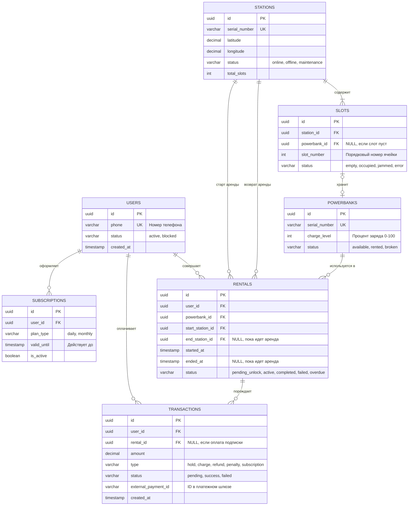
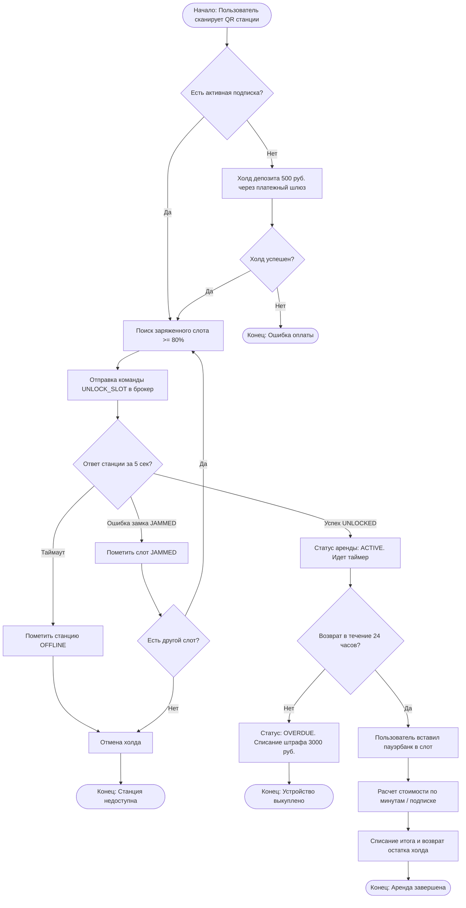
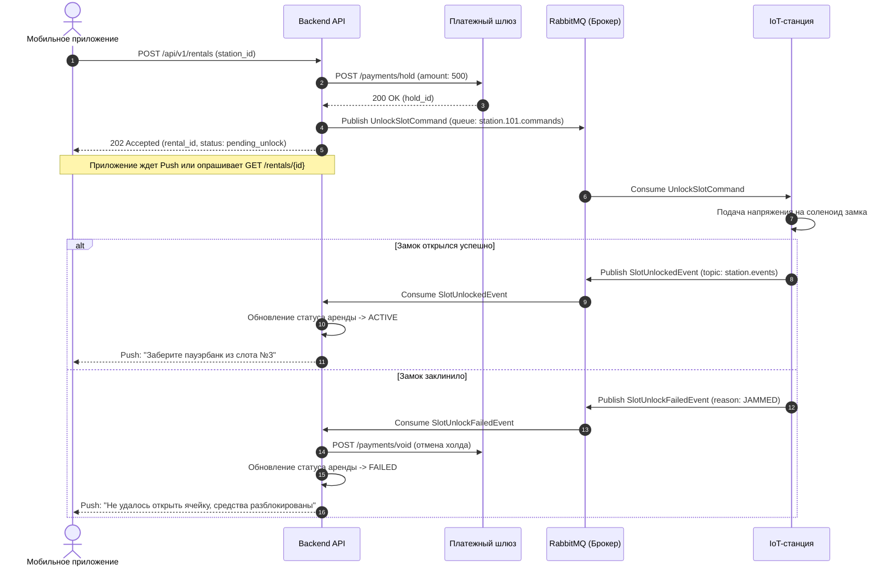

# powerbank-sharing-backend
System architecture, API contracts, and Python PoC for smart powerbank sharing
# Умный шеринг пауэрбанков (System Design & IoT Backend PoC)

Проект демонстрирует проектирование бэкенд-архитектуры для сервиса краткосрочной аренды пауэрбанков с оплатой поминутно или по подписке, интеграцией с платежным шлюзом и асинхронным управлением физическими станциями через брокер сообщений (RabbitMQ).

## Архитектурные артефакты
* **Модель данных (ER-диаграмма):** Учет пользователей, подписок, станций, состояния ячеек, сессий аренды и финансовых транзакций.
* **Бизнес-процессы (UML Activity / Flowchart):** Сценарии взятия и возврата устройства, включая обработку краевых случаев (таймаут станции, заклинивание замка, просрочка возврата).
* **Взаимодействие сервисов (UML Sequence):** Асинхронная разблокировка слота через RabbitMQ без блокировки HTTP-запроса мобильного клиента.
* **Контракты API:** Спецификации [OpenAPI (REST)](docs/openapi.yaml) и [AsyncAPI (Broker Events)](docs/asyncapi.yaml).
* **Proof of Concept (PoC):** Эмулятор IoT-станции и бэкенд-сервиса на Python (`pika`) в папке [`poc/`](poc/).

---

## 1. Модель данных (ER-диаграмма)



---

## 2. Процесс взятия и возврата устройства (Обработка ошибок)



---

## 3. Асинхронная разблокировка слота (Sequence Diagram)



---

## 4. Локальный запуск PoC (Python + RabbitMQ)

1. Перейдите в директорию с кодом и поднимите брокер сообщений:
   ```bash
   cd poc
   docker-compose up -d
   ```
2. Установите зависимости:
   ```bash
   pip install -r requirements.txt
   ```
3. Запустите эмулятор станции в первом терминале:
   ```bash
   python station_emulator.py
   ```
4. Запустите сценарий аренды во втором терминале:
   ```bash
   python backend_service.py
   ```
